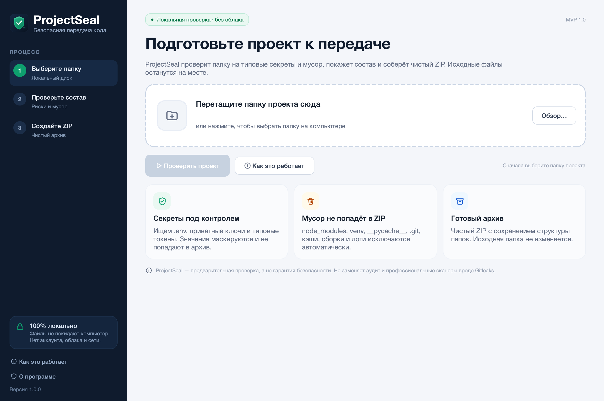
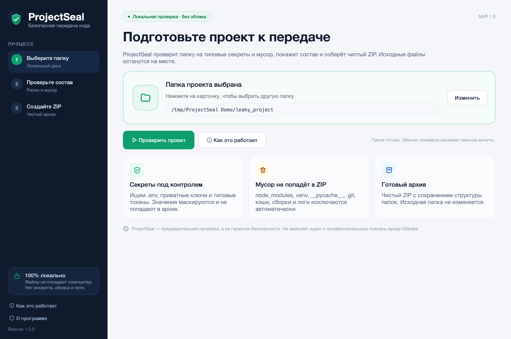
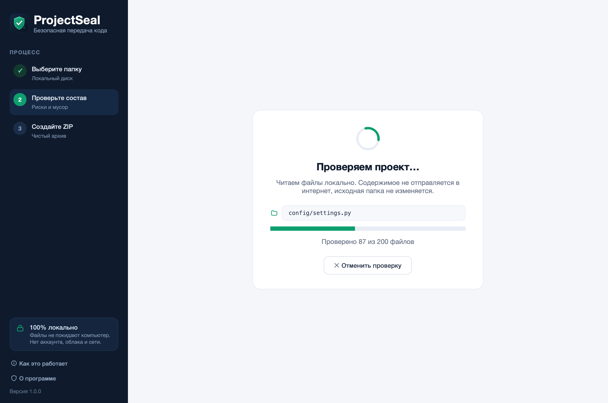
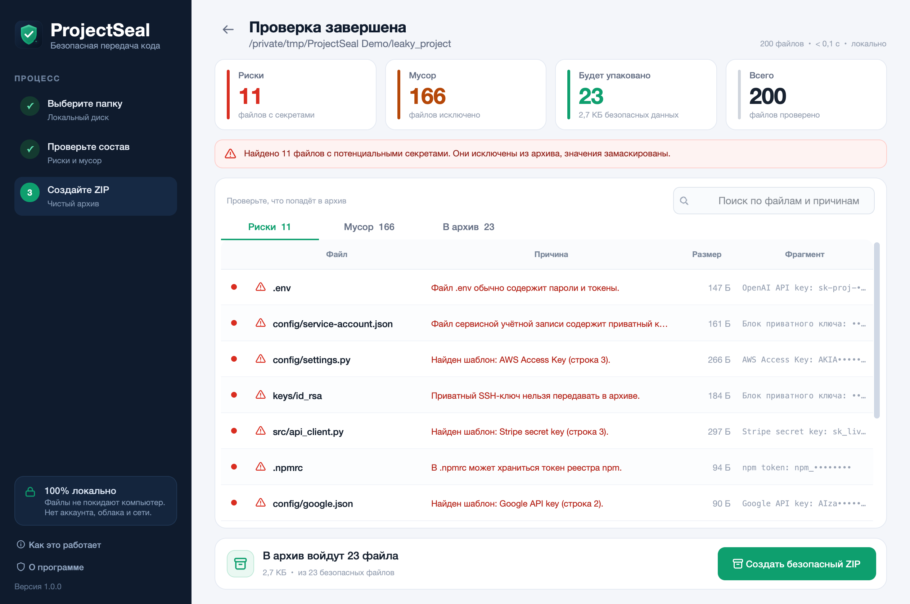
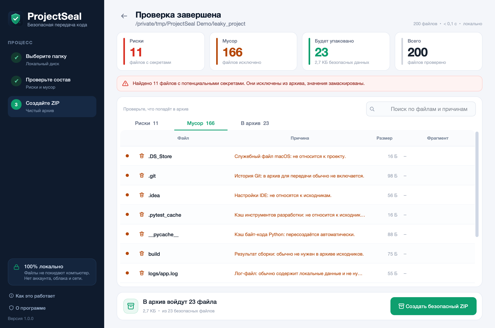
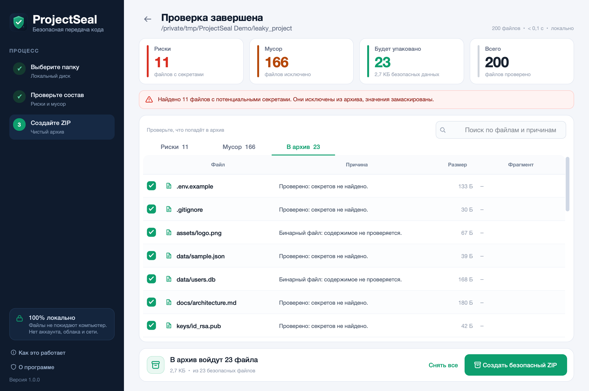
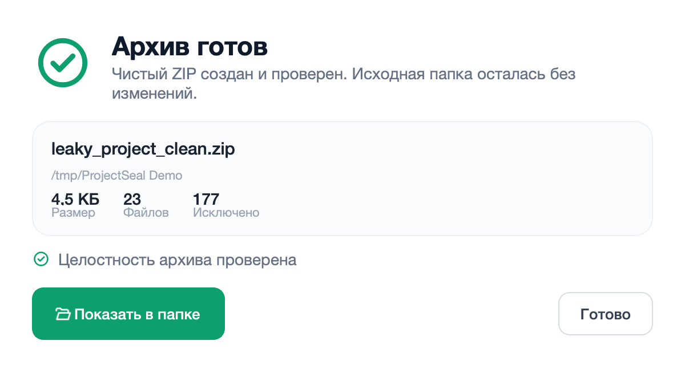

# ProjectSeal

**Проверь проект. Убери лишнее. Отправь ZIP без лишних рисков.**

ProjectSeal — локальное десктопное приложение, которое помогает подготовить папку с исходным кодом к передаче: проверяет её на типовые секреты и мусор, показывает понятный состав будущего архива и создаёт чистый ZIP. Исходные файлы не изменяются, данные не отправляются в интернет.



## Быстрый старт для обычного пользователя

### macOS

1. Скачайте `ProjectSeal-macOS.zip` со страницы **Releases** на GitHub и распакуйте. Либо откройте `dist/ProjectSeal.app` из этой папки.
2. Если macOS не даёт открыть неподписанное приложение: правый клик по `ProjectSeal.app` → **Открыть** → **Открыть**, либо **Системные настройки → Конфиденциальность и безопасность → Всё равно открыть**.
3. Никакой терминал, Python, регистрация и интернет не нужны.

### Windows 10/11

1. Скачайте `ProjectSeal.exe` со страницы **Releases** на GitHub — это готовый файл, Python не нужен.
2. Либо соберите его сами на Windows: запустите `packaging\build_windows.bat` (нужен Python 3.12 x64 и интернет). Скрипт создаст `dist\ProjectSeal.exe`.
3. Пользователь открывает `ProjectSeal.exe` двойным кликом. Терминал не появляется, права администратора не нужны.
4. Если Windows SmartScreen предупреждает: **Подробнее → Выполнить в любом случае**.

> GitHub Actions собирает Windows `.exe` на настоящем Windows-раннере, поэтому готовый файл появляется в Releases автоматически. PyInstaller не кросс-компилирует, и на macOS `.exe` вручную не собрать.

## Что умеет приложение

Ровно три ключевые функции MVP:

1. **Локальная проверка папки.**
   Обход файлов без перехода по символическим ссылкам, поиск типовых секретов (`.env`, приватные ключи, токены AWS/GitHub/OpenAI/Stripe/Slack/Google/JWT) и мусора (`node_modules`, `venv`, `__pycache__`, `.git`, кэши, сборки, логи). Значения секретов маскируются.
2. **Экран проверки состава.**
   Три списка: «Риски», «Мусор», «В архив». У каждого файла — причина и замаскированный фрагмент. Безопасные файлы можно включать и выключать, риск и мусор — нельзя. Работает поиск.
3. **Создание безопасного ZIP.**
   Архив собирается только из выбранных безопасных файлов, сохраняет структуру папок, проверяется на целостность и появляется на диске только после успешной проверки. Исходная папка не меняется.

### Скриншоты

| | |
|---|---|
|  |  |
|  |  |
|  |  |

## Демонстрационные проекты

В папке `demo/`:

* `clean_project` — чистый проект без рисков, хранится в репозитории.
* `leaky_project` — 200 файлов, 11 синтетических секретов, 166 мусорных файлов, 23 безопасных. **В git его нет**: он генерируется локально командой `python tools/make_demo.py`, чтобы GitHub secret scanning не принимал вымышленные токены за настоящую утечку. Все значения синтетические.

Откройте `clean_project` или сгенерированный `leaky_project` в приложении и нажмите «Проверить проект».

## Приватность и ограничения

* Вся обработка локальная: нет сервера, аккаунта, облака и API.
* Исходная папка читается только в режиме read-only; архив сохраняется рядом с проектом, а не внутри него.
* ProjectSeal — **предварительная проверка**, а не гарантия безопасности. Он не анализирует историю Git, содержимое бинарных файлов и не знает все возможные форматы секретов. Не заменяет аудит и Gitleaks.
* Лимиты MVP: 5 000 файлов, 500 МБ суммарно, 5 МБ на один текстовый файл. При достижении лимита приложение предупреждает.
* Значения секретов никогда не показываются полностью и не пишутся в журнал.

## Запуск из исходников (для разработчика)

```bash
python3 -m venv .venv
source .venv/bin/activate            # Windows: .venv\Scripts\activate
pip install -r requirements.txt
python run_projectseal.pyw
```

Альтернативы без терминала для исходников:

* macOS: двойной клик по `ProjectSeal.command` (откроет терминал — это резервный способ; для пользователя используйте `.app`).
* Windows: двойной клик по `ProjectSeal.vbs` — запускает `ProjectSeal.exe`, если он рядом, иначе `pythonw.exe` без консоли.
* Linux: `./ProjectSeal.sh` или `dist/ProjectSeal/ProjectSeal`.

## Тесты

```bash
source .venv/bin/activate
pip install -r requirements-dev.txt
QT_QPA_PLATFORM=offscreen python -m pytest -q
```

В наборе 52 теста: правила и маскирование, сканер и граничные случаи, безопасность ZIP, UI-сценарий, производительность 1 000 файлов.

## Сборка

| ОС | Команда | Результат |
|---|---|---|
| macOS | `bash packaging/build_macos.sh` | `dist/ProjectSeal.app` |
| Windows 10/11 x64 | `packaging\build_windows.bat` | `dist\ProjectSeal.exe` |
| Linux | `pyinstaller --noconfirm --clean packaging/ProjectSeal.spec` | `dist/ProjectSeal/ProjectSeal` |
| GitHub Actions | push тега `v*` | Release: `ProjectSeal.exe` + `ProjectSeal-macOS.zip` |

Сборка выполняется на целевой ОС. Спецификация: `packaging/ProjectSeal.spec`; иконки: `packaging/ProjectSeal.icns`, `packaging/ProjectSeal.ico`.

## Публикация на GitHub и готовые файлы для пользователей

GitHub можно использовать как витрину: **пользователь скачивает один готовый файл из Releases**, а не исходники и не собирает приложение.

### 1. Залить проект

```bash
git init -b main
git add .
git commit -m "ProjectSeal 1.0"
git remote add origin https://github.com/<ваш-логин>/projectseal.git
git push -u origin main
```

`dist/`, `release/`, `.venv` и другие большие артефакты уже исключены через `.gitignore`; в репозиторий попадает исходный код, тесты и демо.

### 2. Дать GitHub собрать Windows `.exe`

В репозитории уже лежит `.github/workflows/build.yml`. На каждый push и на тег `v*` он:

* на `windows-latest` собирает `ProjectSeal.exe` и запускает встроенную self-check;
* на `macos-latest` прогоняет 52 теста, собирает `ProjectSeal.app` и тоже проверяет его;
* на тег `v*` создаёт **GitHub Release** и прикрепляет `ProjectSeal.exe` и `ProjectSeal-macOS.zip`.

### 3. Выпустить версию

```bash
git tag v1.0.0
git push origin v1.0.0
```

Через 5–10 минут откройте **Actions** → последний запуск → **Releases**. На странице релиза будут файлы:

| Файл | Кому |
|---|---|
| `ProjectSeal.exe` | Windows 10/11 x64 — скачать и запустить двойным кликом |
| `ProjectSeal-macOS.zip` | macOS — распаковать и открыть `ProjectSeal.app` |

**Пользователю отправляйте ссылку на Releases, а не на вкладку Code.** Ему нужен только один файл: `.exe` или `-macOS.zip`. Python, терминал и сборка не требуются.

### Если релиз не создался

* **Settings → Actions → General → Workflow permissions** → **Read and write**.
* Тег должен быть вида `v1.0.0`, а не `1.0.0`.
* Логи сборки — вкладка **Actions**.
* Если Windows-раннер недоступен, запасной путь — собрать на Windows через `packaging\build_windows.bat`.

### Подпись и предупреждения

Файлы не подписаны (у учебного MVP нет сертификатов). Windows SmartScreen: **Подробнее → Выполнить в любом случае**. macOS Gatekeeper: правый клик → **Открыть** → **Открыть**. Для коммерческого релиза нужны Authenticode и Apple Developer ID.

## Структура проекта

```text
projectseal/
├── .github/workflows/   # CI: macOS + Windows build, self-check, Release
├── projectseal/
│   ├── core/            # scanner, rules, masking, exporter, models, paths
│   ├── ui/              # main_window, welcome, widgets, dialogs, workers, theme, icons
│   ├── resources/       # rules.json, icon.svg, check.png
│   ├── app.py           # создание QApplication и запуск
│   └── runtime.py       # ресурсы, журнал, аварийные сообщения
├── tests/               # 52 автоматических теста
├── demo/                # clean_project; leaky_project генерируется
├── packaging/           # spec, иконки, скрипты сборки, version_info
├── tools/               # генерация демо, ассетов, скриншотов
├── docs/screenshots/    # скриншоты приложения
├── run_projectseal.pyw  # запуск без консоли
├── ProjectSeal.command  # резервный запуск macOS
├── ProjectSeal.vbs      # запуск Windows без консоли
└── README.md
```
